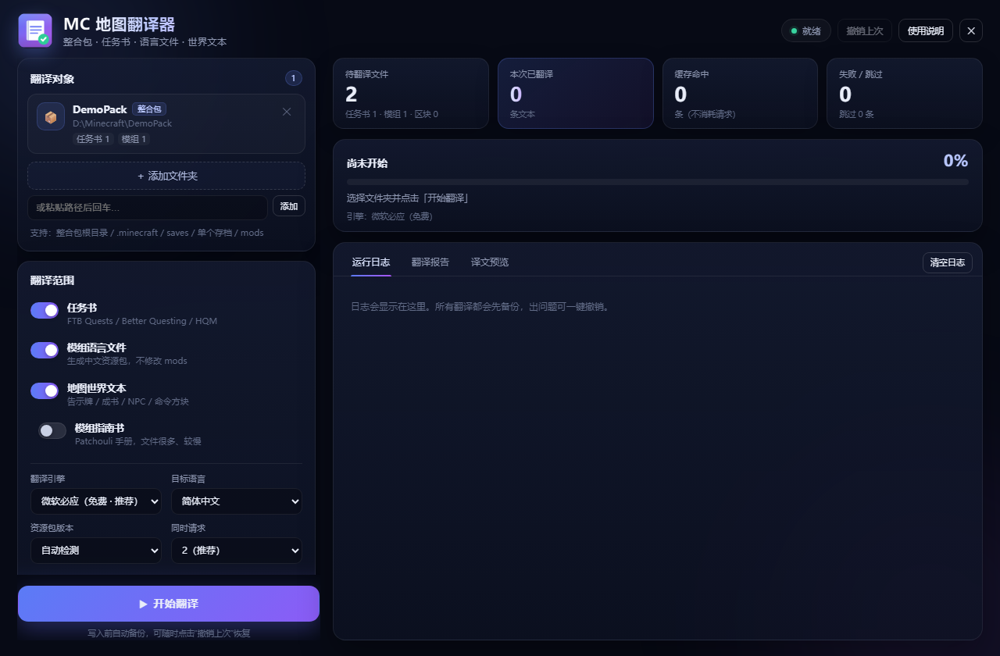
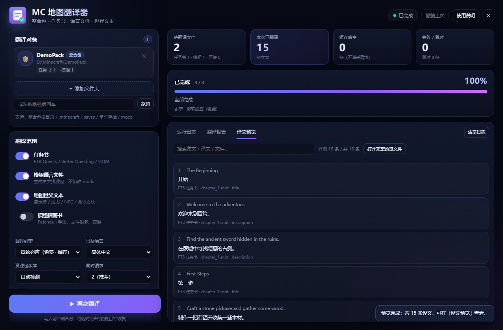
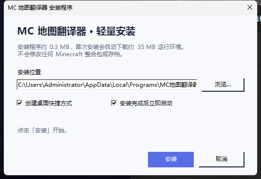

# MC 地图翻译器

一个面向 **Minecraft Java 版** 的批量汉化工具：把整合包、冒险地图、任务书里的英文显示文本自动翻译成简体 / 繁体中文。

免费在线机翻，不需要注册账号或 API Key；带 Windows 图形界面，开箱即用。





## 功能

- **任务书翻译**：FTB Quests（`.snbt` / 旧版 `.nbt`）、Better Questing（`.json`）、HQM 等常见任务书
- **模组语言文件**：读取 `mods` 里各模组的 `en_us.json` / `en_us.lang`，生成中文资源包；**不修改、不重打包任何 `.jar`**
- **地图世界文本**：告示牌、成书、文本展示实体、实体 / 物品自定义名称与 Lore、计分板与队伍名、CustomNPCs 对话
- **命令方块**：只翻译其中的 JSON 显示文本，不改动命令逻辑
- **Patchouli 指南书**（可选）
- **预览模式**：先翻译不写入，逐条查看「原文 → 译文」，满意后再正式执行
- **自动备份 / 一键撤销**：所有修改都有备份，可完整还原
- **翻译缓存**：重复文本只请求一次，二次翻译更快
- **断点可控**：随时停止，已完成的文件都已备份
- **目标语言**：简体中文（`zh_cn`）/ 繁体中文（`zh_tw`）

## 下载与运行

### 方式一：轻量化安装程序（推荐，约 0.3 MB）

[**下载 MC-Map-Translator-Lite-Setup.exe**](https://github.com/danaizui/Minecraft-Map-Translator/raw/main/installer/MC-Map-Translator-Lite-Setup.exe)

双击运行，按提示安装即可。安装程序本身只有约 0.3 MB，首次安装会自动下载约 35 MB 的 Node.js 运行时。

- 默认安装到 `%LOCALAPPDATA%\Programs\MC地图翻译器`
- 自动创建桌面和「开始」菜单快捷方式
- 可在「设置 → 应用 → 已安装的应用」中卸载
- 安装包未签名，SmartScreen 提示时选择「更多信息 → 仍要运行」



> 构建方法与静默安装参数见 [`installer/README.md`](installer/README.md)。

### 方式二：Git clone

```bash
git clone https://github.com/danaizui/Minecraft-Map-Translator.git
cd Minecraft-Map-Translator
```

### 方式三：下载 ZIP

在仓库页面点击 **Code → Download ZIP**，解压到任意目录（路径尽量不要包含特殊符号）。

运行方式：

1. 双击 **`启动.vbs`**：无控制台窗口启动，并自动打开程序界面
2. 如果启动失败，双击 **`启动.cmd`**：会保留控制台并显示错误信息

程序已内置 `runtime\node.exe`，**无需安装 Node.js 或任何依赖**。

> 系统要求：Windows 10 / 11（64 位）。
> 若 `runtime\node.exe` 被安全软件隔离，可自行安装 Node.js 18+，再运行 `启动.cmd`。

## 使用步骤

1. 点击「＋ 添加文件夹」，选择以下任意一种：
   - 整合包根目录（包含 `mods`、`config`、`saves` 的那一层）
   - `saves` 存档文件夹
   - 单个地图 / 存档文件夹（包含 `level.dat`）
   - `.minecraft` 文件夹
2. 在左侧勾选翻译范围、翻译引擎和目标语言。
3. 建议先勾选 **「预览模式」**，点「开始翻译」检查译文。
4. 确认无误后取消预览模式，再点一次「开始翻译」正式写入。
5. 翻译完成后可点右上角「撤销上次」还原。

> 翻译前请关闭 Minecraft，并自行备份重要存档。

## 翻译结果如何生效

| 内容 | 写入位置 | 生效方式 |
| --- | --- | --- |
| 任务书（FTB Quests / Better Questing / HQM） | 原文件（自动备份） | 重启游戏或重新加载任务书 |
| 地图世界文本（告示牌、成书、NPC 等） | 存档内 `region\*.mca`、`data\*.dat`、`customnpcs\*.json` | 重新进入存档 |
| 模组物品 / 方块 / GUI 文本 | `<整合包>\resourcepacks\MC翻译_中文资源包\` | 游戏内「选项 → 资源包」启用 |

模组文本使用资源包覆盖，`mods` 里的 `.jar` **不会被修改**。

## 译文预览

- 翻译完成后会自动切换到「译文预览」标签，显示原文、译文、来源文件与键名
- 顶部搜索框可按原文 / 译文 / 文件名 / 键名筛选
- 界面展示前 300 条，点击「打开完整预览文件」查看全部（最多 5000 条）
- 完整文件：`data\preview.txt`（UTF-8 BOM，记事本可直接打开）

## 备份与撤销

- 备份目录：`backup\<运行ID>\`
- 修改清单：`data\runs\<运行ID>.json`
- 保留最近 10 次记录，更早的自动清理
- 预览模式不会写入任何游戏文件，也不会生成资源包

## 翻译引擎

| 引擎 | 说明 |
| --- | --- |
| 微软必应（默认） | 免费网页接口，速度较快，有频率限制 |
| MyMemory | 备用免费接口，速度较慢 |
| mock | 仅用于自动化测试，生成「【译】」前缀假译文 |

所有译文会缓存在 `data\cache.json`，相同文本不会重复请求。

如果遇到「请求过于频繁」：

- 把「同时请求」调小（例如 1）
- 把「请求间隔」调大（例如 500–1000 毫秒）
- 或切换到 MyMemory

## 命令行（可选）

```bat
runtime\node.exe app\cli.js "D:\Minecraft\MyPack"
runtime\node.exe app\cli.js "D:\Minecraft\MyPack" --engine mymemory
runtime\node.exe app\cli.js "D:\Minecraft\saves\MyMap" --dry-run
runtime\node.exe app\cli.js --undo
runtime\node.exe app\cli.js --help
```

## 目录结构

```text
.
├─ app\                程序代码
│  ├─ server.js        本地 HTTP 服务 + API
│  ├─ cli.js           命令行入口
│  ├─ lib\             NBT / MCA / SNBT / ZIP / 翻译 / 任务书 / 世界文本
│  └─ public\          前端界面
├─ runtime\node.exe    内置 Node.js 运行时
├─ installer\          轻量化安装程序（源码 + Setup.exe）
├─ test\               自动化测试
├─ docs\               README 截图
├─ 启动.vbs            无窗口启动（快捷方式指向它）
├─ 启动.cmd            带控制台启动（排错用）
├─ app.ico             程序图标
├─ backup\             备份（运行时生成）
├─ data\               配置 / 缓存 / 翻译记录（运行时生成）
└─ logs\               运行日志（运行时生成）
```

## 开发与测试

项目零第三方依赖，仅使用 Node.js 内置模块。

```bash
node app/server.js       # 启动本地服务（默认 127.0.0.1:17321）
node app/cli.js --help   # 命令行帮助
node test/run-tests.js   # 运行全部自动化测试
```

测试会构造临时的整合包、地图、语言文件和 MCA 区域文件，覆盖任务书、NBT、MCA、资源包生成、撤销和预览等功能。

## 已知限制

- 仅支持 **Minecraft Java 版**，不支持基岩版
- 不直接读取 `.zip` / `.rar` 整合包，请先解压
- 机器翻译无法保证专有名词、术语和语气的准确性
- 只处理显示文本，不翻译代码、资源路径、配方、进度等内容
- 免费翻译接口可能限流或临时不可用
- 世界文本翻译后写入存档，联机时需同步存档到服务器

## 隐私说明

- 程序只在本机 `127.0.0.1` 上提供界面，不对局域网或公网开放
- 只把提取出的显示文本发送到所选翻译接口（必应 / MyMemory）
- 不收集遥测、不包含广告、不上传存档和日志
- 翻译缓存与日志都保存在本地程序目录

## 许可证

本项目使用 [MIT License](LICENSE) 开源。

内置的 Node.js 运行时版权归 Node.js 项目所有，其许可证见 [`runtime/LICENSE-node.txt`](runtime/LICENSE-node.txt)。

## 免责声明

本工具会修改游戏存档与任务书文件。虽然程序在写入前会自动备份，仍建议自行保留重要存档副本。使用本工具即表示你了解并自行承担相关风险。

Minecraft 是 Mojang Studios 的商标，本项目与 Mojang / Microsoft 无关联。
